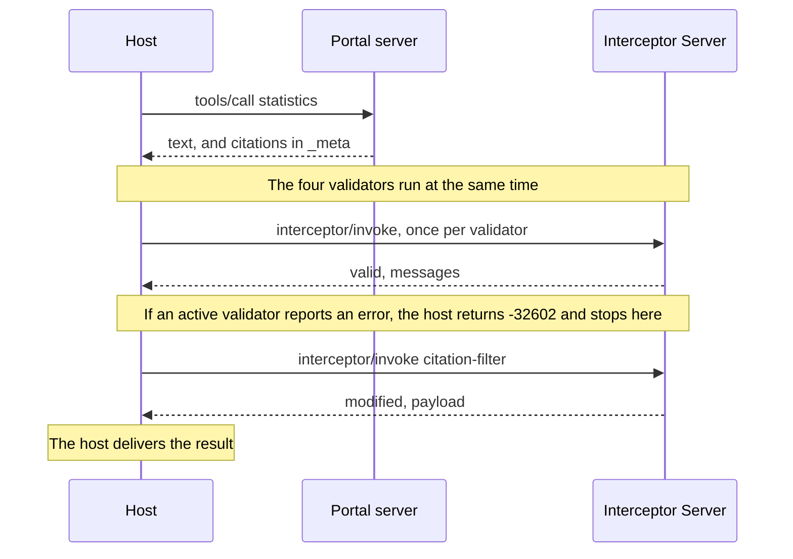

# Citation audit demo

An open data portal's MCP tool answers questions about official statistics and cites its datasets with SEP-3094 citations, carried in the result's `_meta`. Before the answer reaches the user, the host hands it to an Interceptor Server (SEP-2624) that reports bad citations and can remove them.

- Interceptors: the working group draft of [SEP-2624](https://github.com/modelcontextprotocol/modelcontextprotocol/pull/2624), `docs/sep.md` at 07c89a2 in [experimental-ext-interceptors](https://github.com/modelcontextprotocol/experimental-ext-interceptors).
- Citations: [SEP-3094](https://github.com/modelcontextprotocol/modelcontextprotocol/pull/3094) at 109bbfe. A maintainer asked on 2026-11-06 that the proposal go through a working group as an extension, and the PR was closed on 2026-11-08.
- SDK: `@modelcontextprotocol/client` and `@modelcontextprotocol/server` 2.4.0, protocol 2026-07-28, stdio.

## Why open data

The scenario follows a use case the [Open Knowledge Foundation](https://okfn.org) (OKFN) raised [on SEP-3094](https://github.com/modelcontextprotocol/modelcontextprotocol/pull/3094#issuecomment-5522484672). Open licenses can make attribution a [legal requirement of reuse](https://github.com/modelcontextprotocol/modelcontextprotocol/pull/3094#discussion_r4376650397), and public data producers depend on that visibility for funding. OKFN asked for clients that demand citations or warn the user, for servers that can decline clients that will not show them, and for clients that are "more compliant by design". The demo implements one version of each.

This is independent work and not officially associated with OKFN.

## Citations in `_meta`

SEP-3094 at 109bbfe proposes a top-level `citations` field on the tool result. The demo treats that shape as open. Its author [raised an alternative](https://github.com/modelcontextprotocol/modelcontextprotocol/pull/3094#issuecomment-6401849044): return the metadata in `_meta` and process it with interceptors. The demo implements that alternative as input to the next draft.

- The portal server returns the citation array in `_meta["io.modelcontextprotocol/citations"]`. The entries are the SEP's citation objects, unchanged.
- `content` carries what the model needs to cite a source: the `[c1]` markers and their link definitions. The host passes `content` to the model.
- `_meta` carries what the host needs to draw a citation: the dataset's name, publisher, license, quoted row, and thumbnail. The host keeps it.
- The interceptors receive the whole result. They check the markers in `content` against the entries in `_meta`, and the filter edits both.

The MCP specification does not say whether a host shows `_meta` to the model. It [describes `_meta`](https://modelcontextprotocol.io/specification/draft/basic/index#meta) as a way for clients and servers "to attach additional metadata to their interactions", and leaves the meaning of a key to the extension that defines it. The [MCP Apps extension](https://github.com/modelcontextprotocol/ext-apps/blob/main/specification/draft/apps.mdx) lists as a best practice that a tool result's `_meta` holds metadata "not intended for model context". SEP-3094 lets a client that does not render citations "pass them to an LLM as opaque, metadata". The demo's host passes the model `content` only.

### What the demo keeps from SEP-3094, and what it changes

Kept:

- The citation object: the schema.org subset, `display`, and `mcp:annotations.lastModified`.
- The binding: CommonMark links in `content`, keyed by `id` or `name`.
- The `render` flag, and omitting citations for a client that declares no support.

Added:

- `pointer`, a JSON Pointer (RFC 6901) from a citation to the part of the result it supports, such as `/structuredContent/population/2026`. It binds a citation to a value that has no text to hold a marker. The empty pointer is the whole result.

Changed:

- The citations travel in the result's `_meta["io.modelcontextprotocol/citations"]`. A result with them is still a valid `CallToolResult`, so no schema change is needed.
- The citations are not in a content block's `_meta`. A result need not have text blocks, and the proposed result shape below has no content blocks.
- Support is declared as an extension, in `extensions["io.modelcontextprotocol/citations"]`. The SDK drops a top-level `citations` capability.
- The `io.modelcontextprotocol/` prefix is reserved for the specification and official extensions. The demo uses it for a key that no extension defines yet.
- No `mcp:annotations.audience` on a citation. Few clients act on `audience`, so a server cannot count on it. Where a citation goes is set by where it sits: markers in the text for the model, objects in `_meta` for the host.

The checks depend on two things: text the model reads, with markers in it, and a list of citation objects the host reads. Both are set in `src/types.ts`: `citationsOf`, `withCitations`, and `CITATIONS_PATH` for the list, `textOf` and `mapText` for the text. The mod repeats `CITATIONS_PATH` in `hooks/register.tsx`. The checks themselves do not touch `content`.

### Against the proposed tool result shape

The Core Primitives Working Group has an open proposal, [Unified Typed Tool Results](https://github.com/modelcontextprotocol/core-primitives-wg/pull/3) at a1cb53c, with a [problem statement](https://github.com/modelcontextprotocol/core-primitives-wg/pull/2) at e44f13a. It replaces `content` and `structuredContent` with one `result` value and its `resultSchema`, and keeps `_meta`. The demo does not implement it.

- The proposal moves UI-only data for MCP Apps into `_meta["io.modelcontextprotocol/ui"]`. Citation metadata the host draws, under its own `_meta` key, follows the same pattern. The demo's carrier would not move.
- A top-level `citations` field would add a field to a result the proposal reduces to `result`, `resultSchema`, `isError`, and `_meta`.
- The demo reads the answer's text from `content` blocks. Under the proposal that text is `result` when its schema is a string, or the strings in an array of content blocks. `textOf` and `mapText` would change.
- SEP-3094 binds a citation to a claim with a markdown link in text. A typed `result`, such as an array of rows, has no text to hold a marker. The demo's `pointer` covers that case, and under the proposal it would point into `result`.
- In a direct call the host puts `result` into model context, so the markers reach the model as they do now. In programmatic tool calling the generated code receives `result` as a value and chooses what to print. The markers reach the model only if the code prints them, and the proposal does not say whether the code sees `_meta`.
- The proposal removes `annotations.audience` from tool results, and its problem statement says servers cannot rely on the hint for routing. SEP-3094 gives each citation an `mcp:annotations.audience`. The demo drops it.

## The data

The citations point at real Central Statistics Office datasets on [data.gov.ie](https://data.gov.ie), published under CC BY 4.0 and retrieved on 2026-11-11. The demo makes no network requests.

- `corpus/datasets.json` holds the CKAN catalogue records. Each citation's name, license, and publisher come from its record.
- `corpus/PEA01.txt` and `MUM01.txt` are extracts of the CSV files. A citation quotes one CSV row, and the quote check looks for it there. QLF51 has no extract, so its quote is reported as unverified.
- The `unemployment` answer is partly wrong on purpose. Every flawed citation is invented and points at a fictional Northmark dataset on `data.example.org`, a staging address, or nothing. No real dataset is cited for a wrong figure.
- The `inflation` figure is real (CSO table CPM18) and comes with no citation.

The Central Statistics Office and data.gov.ie have no part in this demo.

## Run

Requires Node 24 or later.

```
git clone https://github.com/olaservo/citation-audit-demo
cd citation-audit-demo
npm install
npm run demo
npm test
```

## How it works

`src/host.ts` is the invoker. It calls the `statistics` tool on `src/portal-server.ts`, then runs the interceptors served by `src/interceptor-server.ts`. The checks themselves are plain functions in `src/citation-checks.ts`.



All five interceptors hook the `tools/call` response and declare `mode: "audit"`. The host can override that per interceptor.

| Name | Type | Reports or does |
| --- | --- | --- |
| `citation-binding` | validation | Malformed entries, entries with none of `id`, `name`, `url`, markers in `content` that don't line up with entries in `_meta`, and a `pointer` that names nothing in the result. Optionally, a result with no citations. |
| `citation-url-policy` | validation | Any URL a reader could follow with a scheme other than `https`, or a private, loopback, or link-local host. |
| `citation-quote-check` | validation | A quoted `text` that is not in the cited dataset. `failOpen: true`. |
| `citation-license` | validation | A citation with no `license`, or an attribution license with no `publisher` or `author` to credit. |
| `citation-filter` | mutation | Removes citations with an error from the first three checks, with their markers. The claim stays in the text, uncited. |

The filter never removes a citation for a license error, because that would also remove the credit the license requires.

## What the demo shows

1. `population`: sound citations in the SEP's three link forms, one block-level citation, and one bound by `pointer` to a figure in `structuredContent`. Everything passes.
2. `unemployment` in audit mode: two sound citations and four flawed ones (a figure the dataset does not contain, an entry with no `id`, `name`, or `url`, a private staging URL, and a share-alike dataset with nobody to credit). Findings are logged and the result is delivered unchanged.
3. The same call with the filter promoted to `active`. Three citations are stripped. The share-alike one is delivered flagged.
4. The same call with three validators also promoted to `active`. The result is blocked with `-32602`.
5. `inflation`: no citations, delivered with a warning.
6. A client that declares no citation support gets the text and no citations in `_meta`. With `PORTAL_REQUIRE_RENDER=1` the portal refuses it with a tool error.
7. That client calls through `src/gateway.ts`, which runs the audit for it. `strip` mode returns the stripped text and `block` mode returns `-32602`.

Each citation ends the audit `passed`, `flagged` (an error, delivered anyway), or `stripped`. Only an `error` finding flags, strips, or blocks. A passed citation that quotes its source is shown as `verified` or, when the auditor has no copy of the source, `unverified`.

## Through a gateway

`src/gateway.ts` is an MCP server that runs the host for every `tools/call`, so any MCP client gets audited text with no mod. `GATEWAY_MODE` is `audit`, `strip` (default), or `block`. Findings go to stderr.

```
claude --mcp-config gateway.mcp.json --strict-mcp-config
```

The gateway passes the citations on only to a client that declares support, so it cannot make a client draw them.

## In Claude Code

`mods/citation-audit` makes Claude Code the host and draws the audited citations in the terminal. See [its README](mods/citation-audit/README.md).

## Where the demo departs from the SEPs

- SEP-2624 does not define the response-phase payload, or say whether it includes `_meta`. The demo passes the whole `tools/call` result.
- The carrier and the capability differ from SEP-3094 at 109bbfe. See [Citations in `_meta`](#citations-in-_meta).
- A validation message's `path` reads `_meta["io.modelcontextprotocol/citations"][2].url`. SEP-2624 calls `path` a JSON path and shows only dotted names.
- `PORTAL_REQUIRE_RENDER=1` is not in SEP-3094.
- `citation-url-policy` and `citation-license` are deployment policies. SEP-3094 restricts only what a client fetches automatically, and does not mention licenses. `license` is a schema.org property outside the SEP's subset, read here as a string.
- `citation-url-policy` does not resolve DNS names.
- A timed-out interceptor returns `-32000` on time but is not cancelled, which SEP-2624 requires.
- A halted mutation returns the original payload in `lastValidPayload`.
- The result schemas require `interceptor`, `type`, and `phase`, as the SEP-2624 interfaces do. The SEP's example responses omit them.
- The filter reruns three checks itself, since SEP-2624 gives a mutator no access to validator results. It uses their default severities.
- `mcp:annotations.lastModified` carries CKAN's date for the data's last update, with no time. The SEP's JSON-LD context types it `xsd:dateTime`.
- `@context` is ignored. Every citation is read in the default MCP format.
- Mutator ordering, `failOpen`, timeouts, and hook narrowing are implemented in `src/invoker.ts` but not exercised.
- `src/markdown-links.ts` is a small scanner, not a CommonMark parser.

## Open questions

- The filter does not remove or reorder parts of a result, so pointers stay valid after it runs. What should a mutator that does reorder them be required to do?
- A pointer names one value. Should a citation be able to cover several, or a range of an array?
- In programmatic tool calling, how does the host learn which citations the code's output rests on?
- Citations could also sit inside `result`, described by its schema, where the model and generated code both see them. Which citation fields belong there and which in `_meta`?
- Which of these should a revised SEP-3094 fix: the carrier, or only the two roles, text for the model and metadata for the host?
- The specification does not require a client to declare support before a server sends it a `_meta` key. Should a server still omit the citations for a client that did not declare support?
- The result's `_meta` also holds protocol keys such as `io.modelcontextprotocol/serverInfo`. Should an interceptor receive them, and may a mutator change them?
- The model sees the markers and link definitions and none of the citation objects. Is that enough for it to cite well, or does a host need to pass some of `_meta` on?
- A server that omits the citations for a client without support still returns the text, so attribution-licensed content reaches a client that shows no credit. Should it return less, or refuse?
- SEP-3094 has no convention for a server declining a client that will not render. Is a tool error the right shape?
- Should `render` cover a citation whose marker the model dropped from its answer?
- How should a server mark a citation that must not be removed, or carry share-alike terms?
- Stripping a failing citation also removes the credit its license requires. Should the auditor or the server decide whether to keep it or block the result?
- Should a gateway declare its own citation support to the server, or its client's?

## Acknowledgements

This demo builds on work by members of the MCP community.

- SEP-2624, interceptors: authored by [Sambhav Kothari](https://github.com/sambhav), [Kurt Degiorgio](https://github.com/Degiorgio), and [Peder Holdgaard Pedersen](https://github.com/PederHP), with implementation work in the Interceptors Working Group by [Ukjae Jeong](https://github.com/jeongukjae) and [Monika Campbell](https://github.com/monikaicampbell).
- SEP-3094, citations: authored by [Karthik Palaniappan](https://github.com/karth295).
- The open data use case and the attribution requirements: [Patricio Del Boca](https://github.com/pdelboca) of the Open Knowledge Foundation.
- The discussion on SEP-3094 also drew on [Samuel Klein](https://github.com/metasj), on the uses of citation for attribution, verification, and provenance, and [Mario](https://github.com/MarioPadilla), on citing private documents.
- [Kryspin Ziemski](https://github.com/kziemski) suggested the citations angle on the MCP contributors Discord and brought Karthik Palaniappan in.

They did not write or review this demo.
