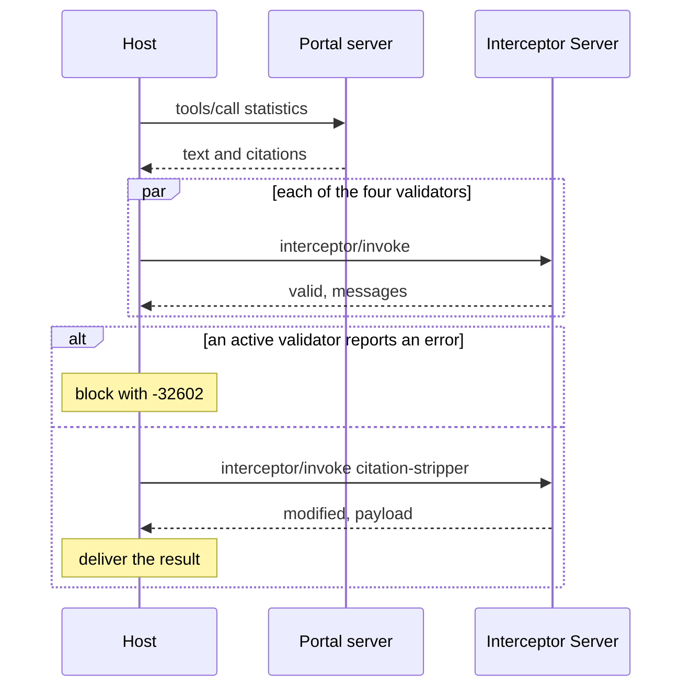

# Citation audit demo

Audits the citations on MCP tool results with interceptors. The scenario is an open data portal: a tool answers a question about official statistics and cites the datasets the figures come from. A host calls the tool, receives a result carrying SEP-3094 citations, and runs four validators and one mutator from an Interceptor Server over it on the `tools/call` response phase before delivering it. The validators report bad citations and the mutator strips them. The host runs in a terminal or inside Claude Code through a mod.

- Interceptors: the working group draft of [SEP-2624](https://github.com/modelcontextprotocol/modelcontextprotocol/pull/2624), `docs/sep.md` at 07c89a2 in [experimental-ext-interceptors](https://github.com/modelcontextprotocol/experimental-ext-interceptors). [Degiorgio/modelcontextprotocol#3](https://github.com/Degiorgio/modelcontextprotocol/pull/3) at 32f00d8 carries the same text.
- Citations: [SEP-3094](https://github.com/modelcontextprotocol/modelcontextprotocol/pull/3094) at 109bbfe. The pull request was closed unmerged on 2026-11-08 with a note to pursue citations as an extension.
- SDK: `@modelcontextprotocol/client` and `@modelcontextprotocol/server` 2.4.0, protocol 2026-07-28, stdio.

## Why open data

The scenario follows a use case the [Open Knowledge Foundation](https://okfn.org) (OKFN), which maintains CKAN, brought to the MCP contributors Discord in September 2026 and to the [discussion on SEP-3094](https://github.com/modelcontextprotocol/modelcontextprotocol/pull/3094#issuecomment-5522484672). OKFN is exploring MCP for open data and public information. Their goal is traceable, attributable answers: asked for the unemployment rate of a place, the answer links to the source dataset on an open data portal.

The reasons they give:

- Open licenses permit reuse on condition of attribution, and share-alike licenses add terms for modified content ([review comment](https://github.com/modelcontextprotocol/modelcontextprotocol/pull/3094#discussion_r4376650397)).
- Public institutions, government statistics bodies, and galleries, libraries, archives, and museums are funded on the visibility and impact of their work. Data producers and the Commons community want attribution too.
- Citations let a consumer ask a server for answers that can be verified.

They reported that they could not steer the model to keep the attribution, that what the user sees depends on each client's frontend and prompt, and that they found no way to enforce it from the protocol side. Their own [server](https://github.com/okfn/mcp-server) requires every tool to return structured output with a `sources` list of URLs, and their demo is at [mcp.okfn.org](https://mcp.okfn.org/).

The demo implements the three behaviours those comments ask about:

| Raised by OKFN | In the demo |
| --- | --- |
| A client that wants citations from a tool, or warns the user | `citation-binding` reports a result with no citations, and the mod shows the warning (`inflation`). |
| A server that does not answer a client that will not render citations | Off by default. With `PORTAL_REQUIRE_RENDER=1` the portal server returns a tool error to a client that does not declare citation rendering. |
| Clients that are "compliant by design" | The Claude Code mod draws the citations from the audited result, so the license, the publisher, and the link are shown whether or not the model repeats them. |

This is independent work. OKFN did not write or review it.

## The data

The citations point at real datasets on [data.gov.ie](https://data.gov.ie), Ireland's open data portal, which runs CKAN. The datasets are published by the Central Statistics Office under CC BY 4.0. Everything was retrieved on 2026-11-11.

- `corpus/datasets.json` holds three catalogue records as CKAN's `package_show` returned them, cut down to `name`, `title`, `notes`, the license fields, `organization`, and `metadata_modified`. Each citation's name, license, publisher, and date come from its record.
- `corpus/PEA01.txt` and `MUM01.txt` are extracts of the datasets' CSV files: the header and a few rows each. A citation's quoted `text` is one CSV row, and `citation-quote-check` looks for it in the extract.
- The demo makes no network requests when it runs. The extracts will go stale as the Central Statistics Office revises its figures.

The `unemployment` answer is partly wrong on purpose so the auditor has something to find. Its two sound citations are real. Every flawed citation is invented: it is about the fictional region of Northmark and points at `data.example.org`, a staging address, or nothing. The invented catalogue records are in `corpus/fictional-datasets.json` and their source texts in `corpus/northmark-*.txt`. No real dataset or publisher is cited for a wrong figure.

The `inflation` figure is real (CSO table CPM18) and is returned with no citation. The Central Statistics Office and data.gov.ie have no part in this demo.

## Run

```
npm install
npm run demo
npm test
```

Requires Node 24 or later.

## Processes

| Process | File | Role |
| --- | --- | --- |
| Host | `src/host.ts` | MCP client of both servers. Invoker in SEP-2624 terms. `src/demo.ts` and `src/audit-cli.ts` drive it. |
| Portal server | `src/portal-server.ts` | Ordinary MCP server. Its `statistics` tool returns text with markdown citation markers and a top-level `citations` array, which it omits for a client that does not declare citations. |
| Interceptor Server | `src/interceptor-server.ts` | Serves `interceptors/list` and `interceptor/invoke`. Hosts no tools, prompts, or resources. |
| Gateway | `src/gateway.ts` | Optional. An MCP server to its client that runs the host for every `tools/call`. See "Through a gateway". |

The Interceptor Server sits beside the host and is not in the path between the host and the portal server.



## Interceptors

All five hook `tools/call`, phase `response`, and declare `mode: "audit"`.

| Name | Type | Does | Config |
| --- | --- | --- | --- |
| `citation-binding` | validation | Every entry has one of `id`, `name`, `url`, and string fields are strings. Reports duplicate ids, ids with no marker or no destination, and markers shaped like citation ids with no entry. Can report a result with no citations at all. | `uncitedSeverity`, default unset |
| `citation-url-policy` | validation | Every URL a reader could follow uses an allowed scheme and does not point at a private, loopback, or link-local address: `url`, `thumbnailUrl`, the markdown link a citation is bound to, and links in the text with no citation. | `allowedSchemes`, default `["https"]` |
| `citation-quote-check` | validation | A citation's quoted `text` appears in the cited dataset. Declares `failOpen: true`. | `unverifiedSeverity`, default `"info"` |
| `citation-license` | validation | Every citation carries a `license`. When the license requires attribution (Creative Commons BY licenses, ODbL, ODC-BY), the citation names a `publisher` or `author`. | `missingSeverity`, default `"error"` |
| `citation-stripper` | mutation | Removes every citation the binding, URL policy, or quote check reports at severity `error`, with its marker and link definition in the text. `priorityHint: -10000`. | `allowedSchemes`, default `["https"]` |

The checks and the strip are plain functions in `src/citation-checks.ts`.

The stripper removes the citation and leaves the claim in the text uncited. Link text is kept as plain text. Findings at `warn` or `info` do not strip, so a marker with no entry (`[c3]` in the demo) stays.

The stripper does not act on a license error. Stripping suits a reader checking an answer: a citation that fails a check is removed and the claim stands uncited. A publisher whose license requires credit is worse off when the citation is removed, so the response to a license error is to block the result.

`citation-url-policy` and `citation-license` are deployment policies. SEP-3094 "Dereferencing citation URIs" restricts what a client fetches automatically and allows MCP-resolved schemes; it does not make a non-https citation invalid. The SEP does not mention licenses. `license` is a schema.org CreativeWork property outside the subset the SEP lists.

## What the demo shows

The host follows the receiving order from SEP-2624: validate in parallel, then mutate in sequence if validation did not block.

1. `statistics(population)` returns sound citations in all three link forms. All validators pass and the stripper returns `modified: false`.
2. `statistics(unemployment)` returns flawed citations: a figure the dataset does not contain, a marker with no entry, a dataset credited with no marker, an entry with no `id`, `name`, or `url`, a staging portal on a private address, a `file:` thumbnail, and a share-alike dataset with nobody named to credit. With the server-declared audit mode the findings are logged, the stripper computes a shadow mutation that is not applied, and the result is delivered unchanged.
3. The same call with an invoker override that promotes `citation-stripper` to `active`. Three of six citations are stripped and the result is delivered with the remaining three. One of the three still has the license error.
4. The same call with `citation-url-policy`, `citation-quote-check`, and `citation-license` also promoted to `active`. The result is blocked with `-32602 Interceptor validation failed` and the stripper does not run.
5. `statistics(inflation)` returns a figure with no citations. The host configures `citation-binding` with `uncitedSeverity: "warn"`, so the result is delivered with a warning.
6. A second client that declares no citation support calls `statistics(population)`. The portal server returns the text and omits `citations`, as SEP-3094 asks. The same call against a portal started with `PORTAL_REQUIRE_RENDER=1` returns a tool error that says it answers only clients that render citations.
7. The same plain client calls `statistics(unemployment)` through the gateway. In `strip` mode it receives the stripped text. In `block` mode it receives the `-32602` error.

Each line of output records the resolved `mode` and `failOpen` and marks the values that came from an invoker override. SEP-2624 "Security Best Practices" also asks for payloads in the log, which the demo does not print.

## Through a gateway

`src/gateway.ts` puts the invoker in a gateway. It lists the portal server's tools as its own, and for each `tools/call` it calls the portal server, runs the interceptors, and returns what the audit delivers. A blocked result reaches the client as the `-32602` error. `GATEWAY_MODE` sets `audit`, `strip` (the default), or `block`, and the findings go to stderr.

```
claude --mcp-config gateway.mcp.json --strict-mcp-config
```

This needs no mod and works for any MCP client. The client receives audited text. The gateway passes `citations` on only to a client that declares support, so Claude Code receives none, and nothing the gateway does makes a client draw a citation.

The gateway declares citation support to the portal server without `render`, since it draws nothing. A portal started with `PORTAL_REQUIRE_RENDER=1` refuses it. The gateway does not forward its client's declaration upstream.

## In Claude Code

`mods/citation-audit` is a Claude Code mod that makes Claude Code the host. Written against Claude Code 2.1.322.

```
claude --plugin-dir mods/citation-audit
```

Start it in this folder so `.mcp.json` adds the portal server. Then ask for statistics on `unemployment`, `population`, or `inflation`. Claude Code's own client declares no citation support, so without the mod it receives the text and no citations.

- A `tool.call` hook answers each `statistics` call by running `src/audit-cli.ts`, which calls the tool as a client that declares citations, runs the interceptors, and prints a report.
- The model reads the audited text and a note listing the citations kept, stripped, and flagged.
- A band above the prompt shows the last audit: the counts and one line per citation, with `Details` and `Hide` buttons. A citation that passed every check is drawn with its license, who to credit, its URL, and an `open` button that opens the exact URL in the browser. A narrow window cuts a long URL short in the row, and the button does not depend on what the row shows. No other citation is drawn as a link. An answer with no citations gets a warning line.
- The same lines are drawn under the tool call's row, and the mod unfolds the group of tool calls that holds it.
- `/citation-audit` opens a pane with the last audit and its findings. `/citation-audit audit`, `strip`, or `block` sets the mode, which maps to scenarios 2, 3, and 4 above. The pane has a button for each mode.
- In `block` mode the model receives the `-32602` error in place of the result.

`npm run test:mod` runs the mod's tests.

Claude Code's own MCP client drops the top-level `citations` field: a mod's `tool.call` hook and `$.mcp.call` both receive `content` only (observed on 2.1.322). A mod also cannot send `interceptor/invoke`, which is not a tool call. So the mod runs the host as a child process for each call, and the portal server in `.mcp.json` only lists the tool for the model. Each call starts three Node processes.

## Open questions

The demo ran into these where attribution, SEP-3094, and SEP-2624 meet. None is settled by either text.

- A server omits `citations` for a client that did not declare support and still returns the text. Attribution-licensed content then reaches a client that will show no credit. Should the server return less, or refuse?
- SEP-3094 defines no error or convention for a server declining a client that will not render. Is a tool error the right shape, and how does the user learn why?
- The client's declaration is self-reported. The server learns what the client says and not what it draws.
- A client that declared `render` should render citations. Does that hold for a block-level citation, or a claim-level one whose marker the model dropped from its answer?
- `license` is outside the SEP's CreativeWork subset. Share-alike and modification-notice terms have no field, and nothing tells the client that a citation must not be removed.
- An auditor that strips a failing citation also removes the credit. The demo blocks on a license error. Is that the auditor's decision or the server's?
- The audit here runs on the host, where the citations are drawn. The gateway runs the same interceptors and cannot see what the client draws. What should a gateway declare to the server: its own support, or its client's?

## Where the demo fills a gap or departs from the SEPs

- SEP-2624 does not define the payload for the response phase. The demo passes the `tools/call` result object.
- SEP-3094 declares the client capability as a top-level `citations` key in `clientCapabilities`. The SDK drops capability keys it does not know. The demo declares `extensions["io.modelcontextprotocol/citations"] = { render: {} }` instead.
- The portal server omits `citations` for a client that did not declare support, as SEP-3094 asks. `PORTAL_REQUIRE_RENDER=1` is outside the SEP: the server returns a tool result with `isError: true` to a client that did not declare `render`.
- The top-level `citations` field on the tool result passes through the SDK on both the server and the client unchanged.
- `citation-quote-check` reads snapshots from `corpus/` keyed by URL and makes no network requests.
- `citation-license` reads `license` as a string and recognises attribution licenses by a short pattern. It does not carry share-alike or modification-notice terms to the client.
- `citation-url-policy` checks the host as written. It does not resolve DNS names, so a public name that resolves to a private address passes.
- SEP-2624 requires a timed-out interceptor to be cancelled. The Interceptor Server returns `-32000` on time and lets the check finish.
- The result schemas require `interceptor`, `type`, and `phase`, as the SEP-2624 interfaces do. The SEP's example responses omit them, and a server answering like the examples is treated as a failed invocation.
- A halted mutation returns the original payload as `lastValidPayload`. The SEP does not define the field.
- A citation's `@context` is ignored. Every citation is read in the default MCP format.
- With one mutator, priority ordering and passing each mutation's output to the next are implemented in `src/invoker.ts` but not exercised. `failOpen`, timeouts, and hook narrowing are also implemented and not exercised.
- The stripper reruns three of the checks itself. SEP-2624 gives a mutator no access to validator results, and interceptor state propagation is listed as future work.
- `src/markdown-links.ts` is a small scanner, not a CommonMark parser. It does not skip code spans.
