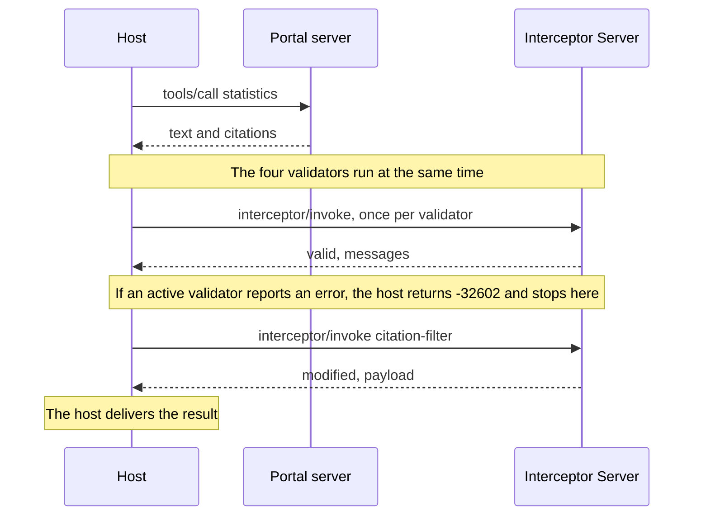

# Citation audit demo

An open data portal's MCP tool answers questions about official statistics and cites its datasets with SEP-3094 citations. Before the answer reaches the user, the host hands it to an Interceptor Server (SEP-2624) that reports bad citations and can remove them.

- Interceptors: the working group draft of [SEP-2624](https://github.com/modelcontextprotocol/modelcontextprotocol/pull/2624), `docs/sep.md` at 07c89a2 in [experimental-ext-interceptors](https://github.com/modelcontextprotocol/experimental-ext-interceptors).
- Citations: [SEP-3094](https://github.com/modelcontextprotocol/modelcontextprotocol/pull/3094) at 109bbfe.
- SDK: `@modelcontextprotocol/client` and `@modelcontextprotocol/server` 2.4.0, protocol 2026-07-28, stdio.

## Why open data

The scenario follows a use case the [Open Knowledge Foundation](https://okfn.org) (OKFN) raised [on SEP-3094](https://github.com/modelcontextprotocol/modelcontextprotocol/pull/3094#issuecomment-5522484672). Open licenses can make attribution a [legal requirement of reuse](https://github.com/modelcontextprotocol/modelcontextprotocol/pull/3094#discussion_r4376650397), and public data producers depend on that visibility for funding. OKFN asked for clients that demand citations or warn the user, for servers that can decline clients that will not show them, and for clients that are "more compliant by design". The demo implements one version of each.

This is independent work and not officially associated with OKFN.

## The data

The citations point at real Central Statistics Office datasets on [data.gov.ie](https://data.gov.ie), published under CC BY 4.0 and retrieved on 2026-11-11. The demo makes no network requests.

- `corpus/datasets.json` holds the CKAN catalogue records. Each citation's name, license, and publisher come from its record.
- `corpus/PEA01.txt` and `MUM01.txt` are extracts of the CSV files. A citation quotes one CSV row, and the quote check looks for it there. QLF51 has no extract, so its quote is reported as unverified.
- The `unemployment` answer is partly wrong on purpose. Every flawed citation is invented and points at a fictional Northmark dataset on `data.example.org`, a staging address, or nothing. No real dataset is cited for a wrong figure.
- The `inflation` figure is real (CSO table CPM18) and comes with no citation.

The Central Statistics Office and data.gov.ie have no part in this demo.

## Run

Requires Node 24 or later.

```
git clone https://github.com/olaservo/citation-audit-demo
cd citation-audit-demo
npm install
npm run demo
npm test
```

## How it works

`src/host.ts` is the invoker. It calls the `statistics` tool on `src/portal-server.ts`, then runs the interceptors served by `src/interceptor-server.ts`. The checks themselves are plain functions in `src/citation-checks.ts`.



All five interceptors hook the `tools/call` response and declare `mode: "audit"`. The host can override that per interceptor.

| Name | Type | Reports or does |
| --- | --- | --- |
| `citation-binding` | validation | Malformed entries, entries with none of `id`, `name`, `url`, and markers that don't line up with entries. Optionally, a result with no citations. |
| `citation-url-policy` | validation | Any URL a reader could follow with a scheme other than `https`, or a private, loopback, or link-local host. |
| `citation-quote-check` | validation | A quoted `text` that is not in the cited dataset. `failOpen: true`. |
| `citation-license` | validation | A citation with no `license`, or an attribution license with no `publisher` or `author` to credit. |
| `citation-filter` | mutation | Removes citations with an error from the first three checks, with their markers. The claim stays in the text, uncited. |

The filter never removes a citation for a license error, because that would also remove the credit the license requires.

## What the demo shows

1. `population`: sound citations in the SEP's three link forms and one block-level citation. Everything passes.
2. `unemployment` in audit mode: two sound citations and four flawed ones (a figure the dataset does not contain, an entry with no `id`, `name`, or `url`, a private staging URL, and a share-alike dataset with nobody to credit). Findings are logged and the result is delivered unchanged.
3. The same call with the filter promoted to `active`. Three citations are stripped. The share-alike one is delivered flagged.
4. The same call with three validators also promoted to `active`. The result is blocked with `-32602`.
5. `inflation`: no citations, delivered with a warning.
6. A client that declares no citation support gets the text and no `citations`. With `PORTAL_REQUIRE_RENDER=1` the portal refuses it with a tool error.
7. That client calls through `src/gateway.ts`, which runs the audit for it. `strip` mode returns the stripped text and `block` mode returns `-32602`.

Each citation ends the audit `passed`, `flagged` (an error, delivered anyway), or `stripped`. Only an `error` finding flags, strips, or blocks. A passed citation that quotes its source is shown as `verified` or, when the auditor has no copy of the source, `unverified`.

## Through a gateway

`src/gateway.ts` is an MCP server that runs the host for every `tools/call`, so any MCP client gets audited text with no mod. `GATEWAY_MODE` is `audit`, `strip` (default), or `block`. Findings go to stderr.

```
claude --mcp-config gateway.mcp.json --strict-mcp-config
```

The gateway passes `citations` on only to a client that declares support, so it cannot make a client draw them.

## In Claude Code

`mods/citation-audit` makes Claude Code the host and draws the audited citations in the terminal. See [its README](mods/citation-audit/README.md).

## Where the demo departs from the SEPs

- SEP-2624 does not define the response-phase payload. The demo passes the `tools/call` result.
- SEP-3094 puts `citations` at the top level of client capabilities, which the SDK drops. The demo declares `extensions["io.modelcontextprotocol/citations"]` instead.
- `PORTAL_REQUIRE_RENDER=1` is not in SEP-3094.
- `citation-url-policy` and `citation-license` are deployment policies. SEP-3094 restricts only what a client fetches automatically, and does not mention licenses. `license` is a schema.org property outside the SEP's subset, read here as a string.
- `citation-url-policy` does not resolve DNS names.
- A timed-out interceptor returns `-32000` on time but is not cancelled, which SEP-2624 requires.
- A halted mutation returns the original payload in `lastValidPayload`.
- The result schemas require `interceptor`, `type`, and `phase`, as the SEP-2624 interfaces do. The SEP's example responses omit them.
- The filter reruns three checks itself, since SEP-2624 gives a mutator no access to validator results. It uses their default severities.
- `mcp:annotations.lastModified` carries CKAN's date for the data's last update, with no time. The SEP's JSON-LD context types it `xsd:dateTime`.
- `@context` is ignored. Every citation is read in the default MCP format.
- Mutator ordering, `failOpen`, timeouts, and hook narrowing are implemented in `src/invoker.ts` but not exercised.
- `src/markdown-links.ts` is a small scanner, not a CommonMark parser.

## Open questions

- A server that omits `citations` for a client without support still returns the text, so attribution-licensed content reaches a client that shows no credit. Should it return less, or refuse?
- SEP-3094 has no convention for a server declining a client that will not render. Is a tool error the right shape?
- Should `render` cover a citation whose marker the model dropped from its answer?
- How should a server mark a citation that must not be removed, or carry share-alike terms?
- Stripping a failing citation also removes the credit its license requires. Should the auditor or the server decide whether to keep it or block the result?
- Should a gateway declare its own citation support to the server, or its client's?

## Acknowledgements

This demo builds on work by members of the MCP community.

- SEP-2624, interceptors: authored by [Sambhav Kothari](https://github.com/sambhav), [Kurt Degiorgio](https://github.com/Degiorgio), and [Peder Holdgaard Pedersen](https://github.com/PederHP), with implementation work in the Interceptors Working Group by [Ukjae Jeong](https://github.com/jeongukjae) and [Monika Campbell](https://github.com/monikaicampbell).
- SEP-3094, citations: authored by [Karthik Palaniappan](https://github.com/karth295).
- The open data use case and the attribution requirements: [Patricio Del Boca](https://github.com/pdelboca) of the Open Knowledge Foundation.
- The discussion on SEP-3094 also drew on [Samuel Klein](https://github.com/metasj), on the uses of citation for attribution, verification, and provenance, and [Mario](https://github.com/MarioPadilla), on citing private documents.
- [Kryspin Ziemski](https://github.com/kziemski) suggested the citations angle on the MCP contributors Discord and brought Karthik Palaniappan in.

They did not write or review this demo.
