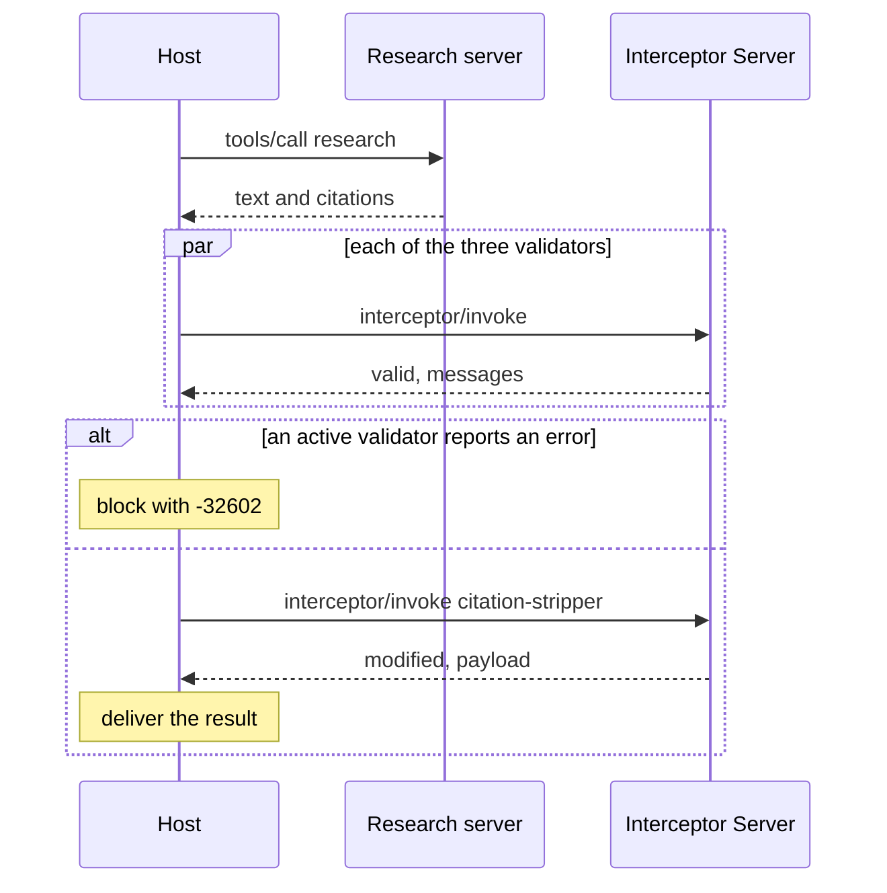

# Citation audit demo

Audits the citations on MCP tool results with interceptors. A host calls a tool, receives a result carrying SEP-3094 citations, and runs three validators and one mutator from an Interceptor Server over it on the `tools/call` response phase before delivering it. The validators report bad citations and the mutator strips them. The host runs in a terminal or inside Claude Code through a mod.

- Interceptors: the working group draft of [SEP-2624](https://github.com/modelcontextprotocol/modelcontextprotocol/pull/2624), `docs/sep.md` at 07c89a2 in [experimental-ext-interceptors](https://github.com/modelcontextprotocol/experimental-ext-interceptors). [Degiorgio/modelcontextprotocol#3](https://github.com/Degiorgio/modelcontextprotocol/pull/3) at 32f00d8 carries the same text.
- Citations: [SEP-3094](https://github.com/modelcontextprotocol/modelcontextprotocol/pull/3094) at 109bbfe. The pull request was closed unmerged on 2026-11-08 with a note to pursue citations as an extension.
- SDK: `@modelcontextprotocol/client` and `@modelcontextprotocol/server` 2.4.0, protocol 2026-07-28, stdio.

## Run

```
npm install
npm run demo
npm test
```

Requires Node 24 or later.

## Processes

| Process | File | Role |
| --- | --- | --- |
| Host | `src/host.ts` | MCP client of both servers. Invoker in SEP-2624 terms. `src/demo.ts` and `src/audit-cli.ts` drive it. |
| Research server | `src/research-server.ts` | Ordinary MCP server. Its `research` tool returns text with markdown citation markers and a top-level `citations` array. |
| Interceptor Server | `src/interceptor-server.ts` | Serves `interceptors/list` and `interceptor/invoke`. Hosts no tools, prompts, or resources. |

The Interceptor Server sits beside the host and is not in the path between the host and the research server.



## Interceptors

All four hook `tools/call`, phase `response`, and declare `mode: "audit"`.

| Name | Type | Does | Config |
| --- | --- | --- | --- |
| `citation-binding` | validation | Every entry has one of `id`, `name`, `url`, and string fields are strings. Reports duplicate ids, ids with no marker or no destination, and markers shaped like citation ids with no entry. | none |
| `citation-url-policy` | validation | Every URL a reader could follow uses an allowed scheme and does not point at a private, loopback, or link-local address: `url`, `thumbnailUrl`, the markdown link a citation is bound to, and links in the text with no citation. | `allowedSchemes`, default `["https"]` |
| `citation-quote-check` | validation | A citation's quoted `text` appears in the cited source. Declares `failOpen: true`. | `unverifiedSeverity`, default `"info"` |
| `citation-stripper` | mutation | Removes every citation the three checks report at severity `error`, with its marker and link definition in the text. `priorityHint: -10000`. | `allowedSchemes`, default `["https"]` |

The checks and the strip are plain functions in `src/citation-checks.ts`.

The stripper removes the citation and leaves the claim in the text uncited. Link text is kept as plain text. Findings at `warn` or `info` do not strip, so a marker with no entry (`[c3]` in the demo) stays.

`citation-url-policy` is a deployment policy. SEP-3094 "Dereferencing citation URIs" restricts what a client fetches automatically and allows MCP-resolved schemes; it does not make a non-https citation invalid. Add schemes with `allowedSchemes`.

## What the demo shows

The host follows the receiving order from SEP-2624: validate in parallel, then mutate in sequence if validation did not block.

1. `research(judicial-review)` returns sound citations in all three link forms. All validators pass and the stripper returns `modified: false`.
2. `research(severance)` returns flawed citations: a quote the source does not contain, a marker with no entry, an entry with no marker, an entry with no `id`, `name`, or `url`, a link-local destination, and a `file:` thumbnail. With the server-declared audit mode the findings are logged, the stripper computes a shadow mutation that is not applied, and the result is delivered unchanged.
3. The same call with an invoker override that promotes `citation-stripper` to `active`. Three of five citations are stripped and the result is delivered with the remaining two.
4. The same call with `citation-url-policy` and `citation-quote-check` also promoted to `active`. The result is blocked with `-32602 Interceptor validation failed` and the stripper does not run.

Each line of output records the resolved `mode` and `failOpen` and marks the values that came from an invoker override. SEP-2624 "Security Best Practices" also asks for payloads in the log, which the demo does not print.

## In Claude Code

`mods/citation-audit` is a Claude Code mod that makes Claude Code the host. Written against Claude Code 2.1.322.

```
claude --plugin-dir mods/citation-audit
```

Start it in this folder so `.mcp.json` adds the research server. Then ask for research on `severance` or `judicial-review`.

- A `tool.call` hook answers each `research` call by running `src/audit-cli.ts`, which calls the tool as a client that declares citations, runs the interceptors, and prints a report.
- The model reads the audited text and a note listing the citations kept, stripped, and flagged.
- A band above the prompt shows the last audit: the counts and one line per citation, with `Details` and `Hide` buttons. Only a citation that passed every check is drawn as a link.
- The same lines are drawn under the tool call's row, and the mod unfolds the group of tool calls that holds it.
- `/citation-audit` opens a pane with the last audit and its findings. `/citation-audit audit`, `strip`, or `block` sets the mode, which maps to scenarios 2, 3, and 4 above. The pane has a button for each mode.
- In `block` mode the model receives the `-32602` error in place of the result.

`npm run test:mod` runs the mod's tests.

Claude Code's own MCP client drops the top-level `citations` field: a mod's `tool.call` hook and `$.mcp.call` both receive `content` only (observed on 2.1.322). A mod also cannot send `interceptor/invoke`, which is not a tool call. So the mod runs the host as a child process for each call, and the research server in `.mcp.json` only lists the tool for the model. Each call starts three Node processes.

## Where the demo fills a gap or departs from the SEPs

- SEP-2624 does not define the payload for the response phase. The demo passes the `tools/call` result object.
- SEP-3094 declares the client capability as a top-level `citations` key in `clientCapabilities`. The SDK drops capability keys it does not know. The demo declares `extensions["io.modelcontextprotocol/citations"] = { render: {} }` instead. The research server omits `citations` when the client does not declare it.
- The top-level `citations` field on the tool result passes through the SDK on both the server and the client unchanged.
- `citation-quote-check` reads snapshots from `corpus/` keyed by URL and makes no network requests. The handbook source is fictional.
- `citation-url-policy` checks the host as written. It does not resolve DNS names, so a public name that resolves to a private address passes.
- SEP-2624 requires a timed-out interceptor to be cancelled. The Interceptor Server returns `-32000` on time and lets the check finish.
- The result schemas require `interceptor`, `type`, and `phase`, as the SEP-2624 interfaces do. The SEP's example responses omit them, and a server answering like the examples is treated as a failed invocation.
- A halted mutation returns the original payload as `lastValidPayload`. The SEP does not define the field.
- A citation's `@context` is ignored. Every citation is read in the default MCP format.
- With one mutator, priority ordering and passing each mutation's output to the next are implemented in `src/invoker.ts` but not exercised. `failOpen`, timeouts, and hook narrowing are also implemented and not exercised.
- The stripper reruns the three checks itself. SEP-2624 gives a mutator no access to validator results, and interceptor state propagation is listed as future work.
- `src/markdown-links.ts` is a small scanner, not a CommonMark parser. It does not skip code spans.
